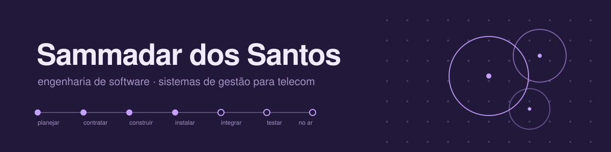
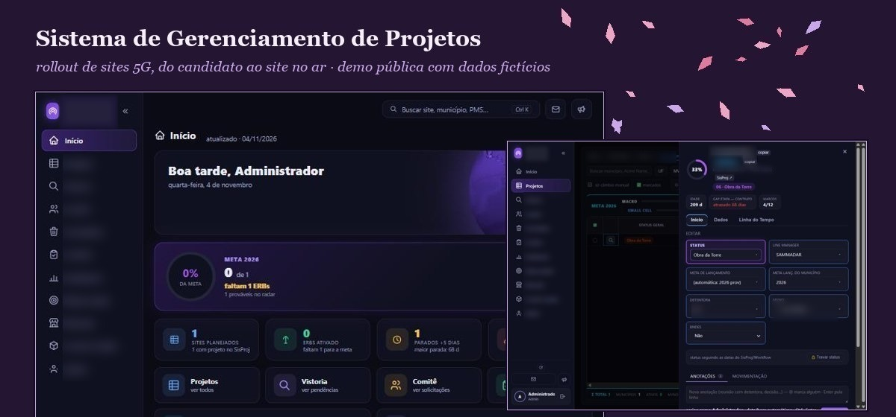
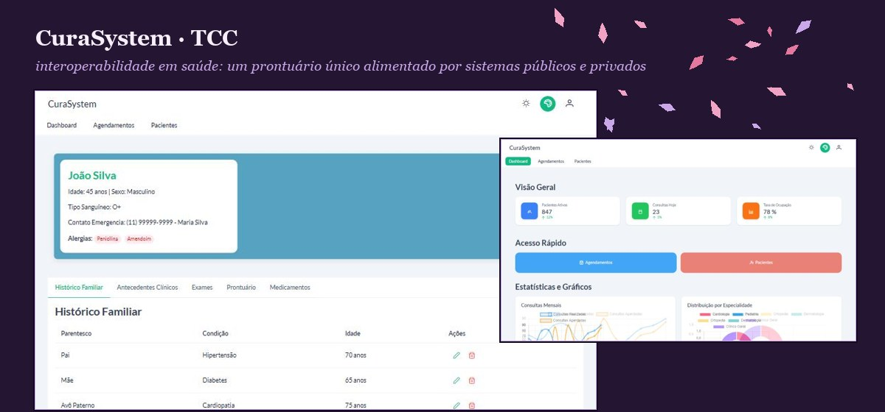

Engenheira de Software. Trabalho em telecom, na área de projetos e processos de rede móvel, e
cuido das melhorias e automações do setor: transformo processos que vivem em planilha e e-mail
em sistemas que as equipes usam todo dia. Gosto de dados bem organizados, telas claras e de ver
uma ideia chegar à produção.

## Projetos

<table>
<tr>
<td width="58%"></td>
<td valign="top">
<b>Sistema de Gerenciamento de Projetos</b>  
Acompanha o rollout de sites 5G: grade com régua de marcos e atrasos, ficha de edição com
auditoria, dashboards, metas regulatórias por estado e relatórios automáticos por e-mail.
Em produção numa operadora; a versão pública é uma demo com dados fictícios.  
FastAPI · MySQL · AD/LDAP · AG Grid · ECharts  
<a href="https://sammadar.github.io/Sistema_gerenciamento_projetos/">abrir a demo</a> (admin / admin) ·
<a href="https://github.com/Sammadar/Sistema_gerenciamento_projetos">código</a>
</td>
</tr>
<tr>
<td></td>
<td valign="top">
<b>CuraSystem · TCC</b>  
Interoperabilidade em saúde: uma plataforma central para onde sistemas públicos e privados
enviam dados e de onde consomem um prontuário único por paciente. Hoje cobre cadastro,
prontuário com histórico, exames e medicamentos, agenda e painel.  
Angular 20 · PrimeNG · FastAPI · SQLAlchemy · MySQL  
<a href="https://github.com/Sammadar/ProjetoTCC">código</a>
</td>
</tr>
</table>

Menores, de estudo:
[Streamilit_acoes](https://github.com/Sammadar/Streamilit_acoes) acompanha uma carteira de ações com cotações ao vivo ·
[RPA_AutomacaoPy](https://github.com/Sammadar/RPA_AutomacaoPy) automatiza consultas de CNPJ e CEP e raspagem de páginas ·
[caixa-ng](https://github.com/Sammadar/caixa-ng) é um caixa em Angular ·
[python-banco-dados](https://github.com/Sammadar/python-banco-dados) é um CRUD em camadas com MySQL.

## Com o que trabalho

| Área | O que uso |
|---|---|
| Linguagens | Python, JavaScript, TypeScript, SQL |
| Back-end | FastAPI, SQLAlchemy, Pydantic, autenticação em AD/LDAP |
| Front-end | Angular e PrimeNG; HTML, CSS e JavaScript puro quando o projeto não pede framework |
| Interface e gráficos | AG Grid, ECharts, Chart.js, FullCalendar |
| Bancos de dados | MySQL, Oracle |
| Dados e automação | Pandas, Power Query, Streamlit, web scraping, integração com APIs internas |
| Ferramentas e entrega | Git, Linux, Docker, Poetry, npm, deploy em servidor próprio com homologação e produção |
| Assistentes de IA | Claude Code e ChatGPT no dia a dia, para desenhar telas, escrever e revisar código e documentar. O que vai para produção eu leio, testo e assino |

## Contato

[linkedin.com/in/sammadar-dos-santos](https://www.linkedin.com/in/sammadar-dos-santos) · [sammadar@outlook.com.br](mailto:sammadar@outlook.com.br)
