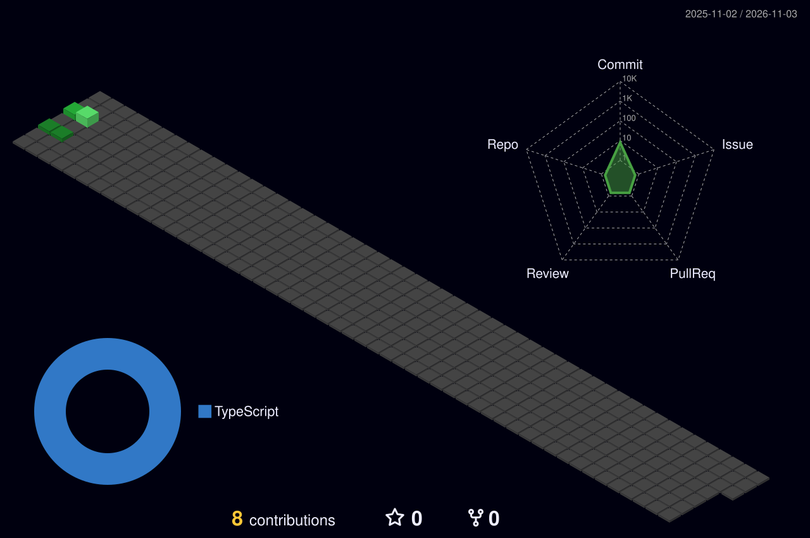

<h1 align="center">Olá, eu sou a Sammadar 👋</h1>

  Engenheira de Software Jr · Full Stack · Python · JavaScript/TypeScript · MySQL 
  Desenvolvo sistemas internos de gestão e automação para uma operadora de telecom.

  
  

---

### 🚀 Projeto em destaque

**[Sistema de Gerenciamento de Projetos](https://github.com/Sammadar/Sistema_gerenciamento_projetos)** · [demo online](https://sammadar.github.io/Sistema_gerenciamento_projetos/) (usuário `admin`, senha `admin`)

Sistema que desenvolvi para acompanhar o rollout de sites 5G, do candidato ao site no ar:
grade de projetos com régua de marcos, GAPs e filtros em cascata, ficha de edição com
auditoria, dashboards, metas regulatórias por estado e relatórios automáticos.
A versão pública é uma demonstração com dados fictícios.

`FastAPI` `MySQL` `AD/LDAP` `AG Grid` `ECharts` `JavaScript` `Python`

---

### 🧰 Outros projetos

| Projeto | O que é | Stack |
|---|---|---|
| [ProjetoTCC](https://github.com/Sammadar/ProjetoTCC) | Trabalho de conclusão de curso: aplicação web completa com front e back separados | Angular 20 · Python |
| [Streamilit_acoes](https://github.com/Sammadar/Streamilit_acoes) | Painel de carteira de ações com cotações em tempo real | Python · Streamlit · yfinance |
| [RPA_AutomacaoPy](https://github.com/Sammadar/RPA_AutomacaoPy) | Automações: consulta de CNPJ e CEP em APIs públicas, web scraping e tratamento de imagens | Python |
| [python-banco-dados](https://github.com/Sammadar/python-banco-dados) | CRUD em camadas (repositórios, telas) com MySQL | Python · MySQL |
| [caixa-ng](https://github.com/Sammadar/caixa-ng) | Aplicação de caixa em Angular | Angular 19 · TypeScript |

---

### 🛠️ Tecnologias

  
  
  
  
  
  
  
  
  

---

  
   
  

  

